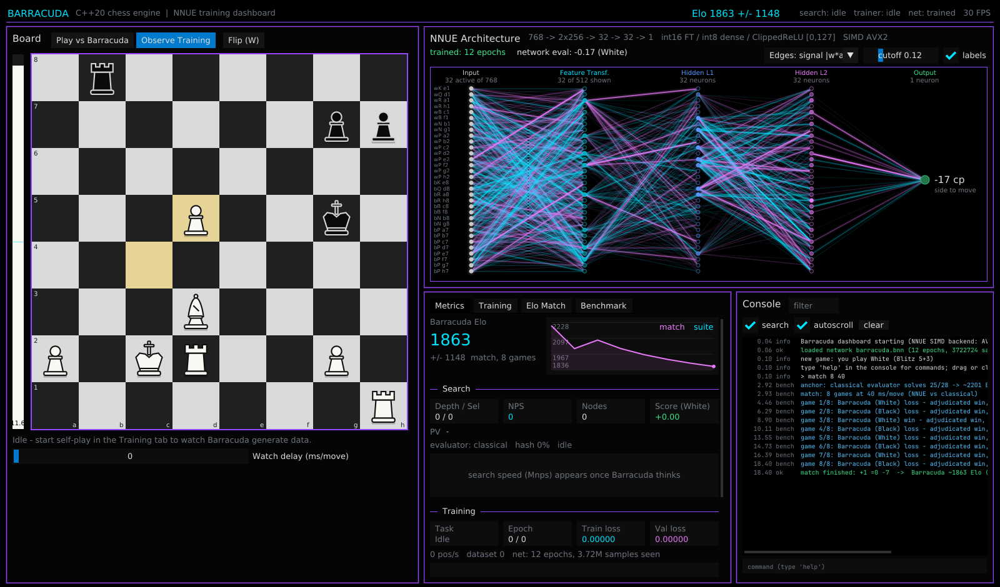

# Barracuda

**A cross-platform C++20 chess engine with a custom NNUE, an offline trainer, and a live ImGui dashboard.**

Barracuda runs fully offline with no LibTorch, ONNX, or Python. Bitboards, legal move generation, alpha-beta search, quantised NNUE inference with AVX2/SSE4.1/scalar kernels, and backpropagation are all written by hand in C++20. A 60 FPS Dear ImGui dashboard sits on top: you can play against the engine, watch self-play games, see the network's activations change, and track loss and an estimated Elo while it trains.



*Screenshot (software-rendered under Xvfb): the user plays White in Blitz 5+3 and the engine has answered 4...Nxe4. The network graph shows the activations of the network trained so far, and the console streams search depth, NPS and PV alongside the epoch losses. The Elo chart shows the tactical-suite estimate after each epoch.*

---

## Contents
1. [Multi-OS setup & build guide](#1-multi-os-setup--build-guide)
2. [Running Barracuda](#2-running-barracuda)
3. [Project file blueprint](#3-project-file-blueprint)
4. [Architecture](#4-architecture)
5. [Implementation milestones](#5-implementation-milestones)
6. [CMake options](#6-cmake-options)
7. [Data formats](#7-data-formats)
8. [Testing & verification](#8-testing--verification)
9. [Known limitations](#9-known-limitations)
10. [Play online: website on GitHub Pages](#10-play-online-website-on-github-pages)

---

## 1. Multi-OS setup & build guide

The only things you install are a compiler, CMake ≥ 3.21, Git, and (on Linux) the windowing/GL **headers**. CMake **FetchContent** downloads and builds **GLFW 3.4** and **Dear ImGui 1.91.5** at configure time, so you don't need any system-wide GUI framework. To build without the GUI (engine, UCI and trainer only), pass `-DBARRACUDA_BUILD_GUI=OFF`; that build needs nothing beyond a compiler.

Minimum compilers: GCC 10, Clang 12, MSVC 19.30 (Visual Studio 2022).

### 1.1 Fedora (GCC/Clang, Wayland or X11)

```bash
sudo dnf install gcc-c++ clang cmake ninja-build git pkgconf-pkg-config \
    libX11-devel libXrandr-devel libXinerama-devel libXcursor-devel libXi-devel libXext-devel \
    mesa-libGL-devel wayland-devel libxkbcommon-devel
```

```bash
git clone <your-fork-url> barracuda && cd barracuda
cmake -S . -B build -G Ninja -DCMAKE_BUILD_TYPE=Release
cmake --build build -j
ctest --test-dir build --output-on-failure
./build/bin/barracuda
```

GLFW is built with **both** the Wayland and X11 backends when their headers are present. On a Wayland session it uses Wayland natively; you can force X11/XWayland by launching with `XDG_SESSION_TYPE=x11 ./build/bin/barracuda` (GLFW follows `XDG_SESSION_TYPE` when both backends are compiled in). Use `CC=clang CXX=clang++ cmake ...` to build with Clang.

### 1.2 Ubuntu (GCC/Clang, X11)

```bash
sudo apt update
sudo apt install build-essential clang cmake ninja-build git pkg-config \
    libx11-dev libxrandr-dev libxinerama-dev libxcursor-dev libxi-dev libxext-dev \
    libgl1-mesa-dev libwayland-dev libxkbcommon-dev
```

```bash
git clone <your-fork-url> barracuda && cd barracuda
cmake -S . -B build -G Ninja -DCMAKE_BUILD_TYPE=Release
cmake --build build -j
ctest --test-dir build --output-on-failure
./build/bin/barracuda
```

The Wayland packages are optional on Ubuntu. If they are missing, configuration detects that and builds an X11-only GLFW instead of failing. Ubuntu 22.04 ships CMake 3.22 and GCC 11, which are both new enough.

### 1.3 Windows 10/11, Visual Studio 2022 (MSVC)

1. Install **Visual Studio 2022** (Community is fine) with the **"Desktop development with C++"** workload. CMake and Ninja are included.
2. Install **Git for Windows**, either with `winget install Git.Git` or from git-scm.com.
3. Open **"x64 Native Tools Command Prompt for VS 2022"**:

```bat
git clone <your-fork-url> barracuda
cd barracuda
cmake -S . -B build -G "Visual Studio 17 2022" -A x64
cmake --build build --config Release --parallel
ctest --test-dir build -C Release --output-on-failure
build\bin\Release\barracuda.exe
```

Alternatively, choose **File → Open → Folder…** in Visual Studio. It reads `CMakePresets.json`, so you can pick `msvc-release` and press F5. With a single-config generator such as Ninja (`cmake --preset release`), the binaries land in `build\bin\` with no `Release\` subfolder.

### 1.4 Windows, MSYS2 / MinGW-w64

From the **MSYS2 UCRT64** shell:

```bash
pacman -S --needed git mingw-w64-ucrt-x86_64-toolchain mingw-w64-ucrt-x86_64-cmake mingw-w64-ucrt-x86_64-ninja
```

```bash
git clone <your-fork-url> barracuda && cd barracuda
cmake -S . -B build -G Ninja -DCMAKE_BUILD_TYPE=Release
cmake --build build -j
./build/bin/barracuda.exe
```

The MinGW executables link `libgcc`, `libstdc++` and `winpthread` statically (`BARRACUDA_STATIC_RUNTIME=ON`), so they run outside the MSYS2 shell.

### 1.5 CMake presets (all platforms)

```bash
cmake --list-presets
cmake --preset release && cmake --build --preset release
cmake --preset headless && cmake --build --preset headless   # no GUI deps needed
```

### 1.6 Offline / air-gapped builds

Put the dependency sources in `third_party/glfw` and `third_party/imgui` (for example as git submodules at tags `3.4` and `v1.91.5`). CMake picks them up automatically. You can also point at existing checkouts with `-DFETCHCONTENT_SOURCE_DIR_GLFW=<dir> -DFETCHCONTENT_SOURCE_DIR_IMGUI=<dir>`.

---

## 2. Running Barracuda

### 2.1 Dashboard (`barracuda`)

| Panel | What it shows |
|---|---|
| **Board** (left) | **Play vs Barracuda**: drag or click to move, with legal-move hints, promotion picker, eval bar, chess clocks (1+0 up to 15+10, or fixed engine time), undo, swap sides and move list. **Observe Training**: the self-play game currently being generated, with an optional watch delay. |
| **NNUE Architecture** (top right) | A node-link graph of `inputs → feature transformer → L1 → L2 → output`. Node brightness is the ClippedReLU activation. Edge colour is the weight sign (cyan +, rose −), and edge brightness is \|w·a\| or \|w\|. Hover a node to highlight its connections. During training the graph refreshes about once a second from the live weights. |
| **Metrics** (bottom middle) | Barracuda's **Elo** (also shown in the top bar) and its history, search stats (depth, NPS, nodes, score, PV), training stats, the loss curve and per-epoch train/val loss. The **Training** tab holds the self-play, training and network-file controls; the **Elo Match** tab plays the network against the classical evaluator and reports Elo with a 95% margin; the **Benchmark** tab runs WAC/STS-style EPD suites. |
| **Console** (bottom right) | A live log of epochs, losses, search depth, NPS and PV, and benchmark results, with a filter and a command line (`help`). |

**Quick start loop** (all inside the GUI):
1. **Training → Self-play + train.** The worker plays games and writes `selfplay.txt`, then trains `barracuda.bnn` on them. It saves a checkpoint and runs a benchmark after every epoch.
2. Watch the games in **Observe Training** and the loss and Elo curves in **Metrics**.
3. Switch to **Play vs Barracuda**. In *Auto* mode the engine uses the NNUE once the network has seen at least 1M training samples; you can force *Classical* or *NNUE* in **Training → Evaluator**.

On startup the dashboard loads `barracuda.bnn` from the working directory if one exists. Useful flags: `--exec "<console command>"` (repeatable), `--no-vsync`, `--fps N`, and `--screenshot out.ppm --frames N` for headless smoke tests.

### 2.2 Command line / UCI (`barracuda-cli`)

```bash
./build/bin/barracuda-cli                       # UCI mode: plug into Cute Chess, Arena, BanksiaGUI, ...
./build/bin/barracuda-cli perft 6               # move generator check
./build/bin/barracuda-cli bench 12              # fixed-depth node count / speed
./build/bin/barracuda-cli selfplay --games 2000 --depth 7 --threads 8 --out selfplay.txt
./build/bin/barracuda-cli train --data selfplay.txt --epochs 15 --out barracuda.bnn
./build/bin/barracuda-cli suite --movetime 1000             # built-in WAC subset + Elo estimate
./build/bin/barracuda-cli match --games 100 --movetime 100   # NNUE vs classical: Elo +/- margin
./build/bin/barracuda-cli suite --file wac.epd --movetime 500 --net barracuda.bnn
```

The UCI options are `Hash`, `EvalFile` and `EvalMode` (Auto/Classical/NNUE). The non-standard commands `d`, `eval`, `perft N` and `bench N` are also accepted.

---

## 3. Project file blueprint

```
barracuda/
├── CMakeLists.txt                 # root: options, subdirectories, summary
├── CMakePresets.json              # release / debug / headless / msvc / native presets
├── cmake/
│   ├── BarracudaCompilerFlags.cmake   # -O3 / /O2, warnings, AVX2/SSE4.1 detection, LTO
│   ├── BarracudaDependencies.cmake    # FetchContent GLFW + Dear ImGui (X11/Wayland autodetect)
│   └── detect_avx2.cpp                # host CPU probe (try_run)
├── engine/                        # ── barracuda::core + barracuda::engine ──
│   ├── include/barracuda/engine/
│   │   ├── types.h         # Square/Piece/Move(16-bit)/Value
│   │   ├── bitboard.h      # uint64 bitboards, fancy-magic slider attacks
│   │   ├── zobrist.h       # hashing keys
│   │   ├── position.h      # bitboards + mailbox, make/unmake, SEE, repetition
│   │   ├── movegen.h       # legal generator (pins, checks, ep, castling, promotions), perft
│   │   ├── notation.h      # UCI / SAN, game result
│   │   ├── evaluate.h      # hand-crafted fallback eval (tapered PST, pawns, mobility)
│   │   ├── tt.h            # transposition table
│   │   ├── search.h        # iterative-deepening PVS + quiescence
│   │   ├── selfplay.h      # training-data generator
│   │   └── suite.h         # EPD suites (WAC subset built-in) + Elo estimate
│   └── src/*.cpp
├── nnue/                          # ── barracuda::nnue ──
│   ├── include/barracuda/nnue/
│   │   ├── architecture.h  # 768 → 2×256 → 32 → 32 → 1, quantisation constants
│   │   ├── network.h       # int16/int8 inference, Accumulator(+Stack), add/sub_feature
│   │   ├── float_network.h # float master weights, .bnn file format
│   │   ├── dataset.h       # FEN | cp | WDL parser, packed samples
│   │   ├── trainer.h       # multi-threaded backprop + Adam
│   │   └── inspector.h     # activation/weight snapshot for the visualiser
│   └── src/*.cpp
├── gui/                           # ── barracuda (dashboard executable) ──
│   └── src/
│       ├── main.cpp                # GLFW/OpenGL3/ImGui render loop (60 FPS cap)
│       ├── app.{h,cpp}             # layout, top bar, console commands
│       ├── theme.{h,cpp}           # dark minimalist palette + font discovery
│       ├── widgets.{h,cpp}         # vector chess pieces, charts, eval bar, tiles
│       ├── runtime/                # thread boundary - no ImGui in here
│       │   ├── concurrency.h       # lock-free TripleBuffer + MPMC ring queue
│       │   ├── shared_state.h      # snapshots, Logger, NetworkRegistry
│       │   ├── search_worker.*     # play/analysis search thread
│       │   └── training_worker.*   # self-play / dataset / training / benchmark thread
│       └── panels/                 # board, network, metrics, console
├── app/main.cpp                   # barracuda-cli (UCI + perft/bench/selfplay/train/suite)
├── tests/test_main.cpp            # perft, hashing, SAN, search, NNUE, trainer, lock-free tests
├── docs/                          # ARCHITECTURE.md, screenshot
└── .github/workflows/ci.yml       # Ubuntu GCC/Clang, Fedora, Windows MSVC + MinGW
```

Dependency direction: `core ← nnue ← engine ← {cli, gui}`. The GUI's `runtime/` layer never includes ImGui, and the panels never touch engine internals from the render thread.

---

## 4. Architecture

A deeper write-up is in [`docs/ARCHITECTURE.md`](docs/ARCHITECTURE.md). In brief:

**Engine core.** The board is held as 64-bit bitboards (6 piece-type sets plus 2 colour sets) with a mailbox alongside. Slider attacks use fancy magic bitboards, with the magics generated deterministically at startup. The move generator is fully legal: it detects pins via x-raying snipers, restricts check evasions to the checker and blocking squares, verifies en passant by simulating the capture (which catches the horizontal-pin case), and checks castling through attacked squares. It is validated with perft on 6 standard positions (including Kiwipete and positions 3 to 6).

**Search.** Iterative deepening with aspiration windows drives a negamax/PVS alpha-beta search. Leaves go to quiescence search with SEE and delta pruning. Move ordering is TT move → good captures (MVV-LVA) → queen promotions → two killer moves per ply → history heuristic. The transposition table is Zobrist-keyed with 2-way buckets (depth-preferred plus always-replace) and mate-distance-adjusted scores. Pruning and extensions: null move, reverse futility, futility, late move pruning/reductions, internal iterative reduction, check extension and mate-distance pruning. Time management handles movetime, clock plus increment, and node limits.

**NNUE.** The 768 binary inputs encode colour × piece × square relative to each perspective. The feature transformer uses int16 weights, and two int16 accumulators are updated incrementally from the 1–3 dirty pieces of each move (`add_feature`/`sub_feature`, fused into one SIMD pass). Activation is ClippedReLU `min(max(0,x),127)` producing uint8, followed by int8 dense layers using `_mm256_maddubs_epi16` → `_mm256_madd_epi16`, with >>6 requantisation and a centipawn output. Training happens in float space with exactly the same clipping semantics, so quantisation is just rounding. The test suite measures float-vs-int drift.

**Trainer.** The target is `λ·σ(cp/400) + (1−λ)·WDL`, optimised as MSE in win-probability space with Adam and per-epoch learning-rate decay. Mini-batches are split across threads, and each thread keeps sparse FT gradient rows. Weights are clamped to their quantisable ranges, and a checkpoint is written after every epoch.

**Threads.**
```
 render thread (60 FPS)            search worker                    training worker (+ trainer helper threads)
 ─────────────────────             ─────────────                    ──────────────────────────────────────────
 ImGui panels  ──commands──▶  Go / Inspect / NewGame         SelfPlay / Train / Benchmark / Save / Load
     ▲  (mutex+cv queue, push only)         │                               │
     │                                      ▼                               ▼
     └── TripleBuffer::update() ◀── SearchSnapshot, MoveResult,   TrainingSnapshot, ObservationSnapshot,
         (lock-free, never blocks)       NetworkView                 NetworkView
     └── MpmcQueue::try_pop()   ◀────────── log lines from every thread (lock-free) ──────────┘
                    NetworkRegistry: shared_ptr<const Network> swap between workers (never on the render path)
```

---

## 5. Implementation milestones

| # | Milestone | Contents | Verification |
|---|---|---|---|
| M1 | **Engine core** | types, bitboards, magics, Zobrist, position, legal movegen, SAN/UCI, classical eval, TT, search, UCI CLI | perft suite (6 positions) passes; mate/tactics tests; built-in WAC subset |
| M2 | **NNUE** | quantised network + SIMD kernels, accumulator stack, float master + file format, dataset parser, multi-threaded trainer, self-play generator | incremental == refresh over 20 random games; float-vs-int drift < 25 cp; trainer loss drops > 30 % on a toy set |
| M3 | **GUI & visualiser** | GLFW/ImGui shell, theme, vector pieces, board (play/observe), network graph, metrics/charts, console | rendered under Xvfb (`--screenshot`) |
| M4 | **Integration** | worker threads, lock-free snapshots, NetworkRegistry, live training view, per-epoch benchmark/Elo, CI | ThreadSanitizer run of the full GUI doing self-play + training + play search at once: 0 reports |

All four milestones are implemented in this repository.

---

## 6. CMake options

| Option | Default | Meaning |
|---|---|---|
| `BARRACUDA_BUILD_GUI` | `ON` | Build the dashboard (fetches GLFW + ImGui) |
| `BARRACUDA_BUILD_CLI` | `ON` | Build `barracuda-cli` |
| `BARRACUDA_BUILD_TESTS` | `ON` | Build `barracuda_tests` (CTest) |
| `BARRACUDA_SIMD` | `AUTO` | `AUTO` probes the build host via cpuid (`AVX2` → `-mavx2 -mbmi2 -mfma` / `/arch:AVX2`, else `SSE41`); also `AVX2`, `SSE41` or `NONE` (scalar) |
| `BARRACUDA_NATIVE` | `OFF` | `-march=native` (GCC/Clang) |
| `BARRACUDA_LTO` | `ON` | IPO/LTO in Release when supported |
| `BARRACUDA_STATIC_RUNTIME` | `ON` | MinGW: static libgcc/libstdc++/winpthread |
| `BARRACUDA_WINDOWED` | `OFF` | Windows: GUI subsystem (no console window) |

Release flags are `-O3 -funroll-loops -fno-math-errno` on GCC/Clang and `/O2 /Oi /Ot /Gy /GS-` on MSVC. **Note:** `AUTO` tunes for the machine that builds the binary. If you want to distribute binaries to older CPUs, use `-DBARRACUDA_SIMD=SSE41` or `NONE`.

---

## 7. Data formats

**Training data** has one position per line. The score is in centipawns from **White's** point of view, and the result is from White's point of view:
```
rnbqkbnr/pppppppp/8/8/4P3/8/PPPP1PPP/RNBQKBNR b KQkq - 0 1 | 35 | 0.5
8/8/4k3/8/8/4K3/4P3/8 w - - 0 1 [1.0] 250          # "legacy" layout is accepted too
```
Results may be written as `1.0/0.5/0.0`, `1-0/1/2-1/2/0-1` or `w/d/b`.

**Network files** (`.bnn`) contain `"BRCDNNUE"`, a version, the dimensions, epoch and sample counters, then the float32 tensors. The file stores float master weights, which are quantised on load, so a checkpoint can be both played with and trained further.

**EPD suites** use standard EPD with `bm`/`am`/`id` (SAN moves). Entries with an illegal FEN or move are skipped and counted.

---

## 8. Testing & verification

```bash
ctest --test-dir build --output-on-failure      # or ./build/bin/barracuda_tests [filter]
./build/bin/barracuda-cli perft 6               # startpos: 119060324
```

Checks run while developing this repository (Ubuntu 24.04, GCC 13.3 and Clang 18):
- `barracuda_tests` passes with the AVX2, SSE4.1 and scalar kernels, and under ASan+UBSan.
- The lock-free primitives and the multi-threaded trainer are clean under TSan, and so is the full dashboard running self-play, training and a play search at the same time.
- The GCC and Clang builds produce zero warnings with `-Wall -Wextra -Wpedantic`.
- On the built-in 28-position WAC subset at 1 s/move, the classical evaluator solves 26 of 28.
- End to end: 3,000 self-play games at depth 7 produced 320K positions, and 12 epochs of training on them took validation loss from 0.0045 to 0.0034 at about 250K positions/s on 4 threads. The resulting NNUE searches at about 0.94M nps on the bench positions and solves as many suite positions as the classical eval (25 of 28 each at 500 ms).

**Not verified:** Windows (MSVC and MinGW) and Fedora builds are covered by the CI workflow (`.github/workflows/ci.yml`) but have not been run yet. Please check the first CI run.

---

## 9. Known limitations

- **How the Elo is computed.** The *Elo Match* plays the network against Barracuda's own classical evaluator in colour-swapped games, which is a real measurement with a 95% margin (it needs 100+ games to get under about ±60). The headline number adds that to an anchor for the classical evaluator taken from the 28-position tactical suite, and that anchor is only a heuristic. Treat the result as a trend indicator rather than an official rating; for that, play matches against other engines with `barracuda-cli` in Cute Chess or fastchess.
- **No network weights are shipped.** You bootstrap one with self-play from the classical eval. A network trained on only a few thousand positions is much weaker than the classical eval, which is why *Auto* mode waits until the net has seen 1M samples.
- The search is single-threaded (no Lazy SMP yet), and the engine supports standard chess only (no Chess960).
- The GUI uses OpenGL 3.3 core. Very old GPU drivers, or VMs without 3D acceleration, may need Mesa's software renderer (`LIBGL_ALWAYS_SOFTWARE=1`).

---

## 10. Play online: website on GitHub Pages

`web/` is a static site where anyone can play against Barracuda. The engine is compiled to **WebAssembly** and runs inside the visitor's browser (in a Web Worker), so there is no server to run or pay for. The site has the same black and purple look as the dashboard, a drag-and-click board, six strength levels, an evaluation bar, undo, and a panel showing the published network (epochs trained, Elo, update date).

**Publishing the site (one time)**
1. Merge your branch into `main` (the deploy workflow in `.github/workflows/pages.yml` runs on `main`).
2. On GitHub: **Settings → Pages → Build and deployment → Source: GitHub Actions**. GitHub Pages on a *private* repository needs a paid GitHub plan; if the repository is free and private, make it public.
3. Push to `main`. The workflow builds the WebAssembly module, runs a smoke test, and deploys. The site appears at `https://<your-user>.github.io/<repo>/`.

**Updating the site after more training**
```bash
./build/bin/barracuda-cli publish --net barracuda.bnn --games 100
git add web/net && git commit -m "Update network" && git push
```
`publish` plays the network against the classical evaluator, then writes `web/net/manifest.json` (epochs, samples, Elo with its margin, date) and copies the network next to it. **The site only switches to the network when it beats the classical evaluator in that match**; otherwise the manifest keeps the site on the classical evaluator and says so. `--force-nnue` overrides that, and `--games 0` skips the match. The network file is always published, because the page draws it in the **Neural network** panel: the real activations and weights, refreshed every time the search finishes a depth (the network evaluates the end of the line being analysed), with pulses travelling along the strongest connections while the engine thinks. When the network is not playing yet, the panel says so.

**Levels.** Beginner, Casual and Club are shallow fixed-depth searches that answer almost instantly. Advanced, Expert and Maximum use their whole time budget, roughly 1 s, 2 s and 4 s per move on a typical computer.

**Building and testing locally**
```bash
web/build.sh                                  # needs Emscripten (emcc) on PATH
node web/test/wasm_test.mjs barracuda.bnn     # engine checks under Node
python3 -m http.server -d web 8000            # then open http://localhost:8000
```
The WebAssembly build uses the same SSE4.1 NNUE kernels (mapped to WASM SIMD), and its network evaluations match the native build exactly. Visitors' games are not collected: training only happens on your machine.

**One screen, any screen.** On a desktop-sized window the whole page fits without scrolling (board, controls, the neural network and the move list). On phones, tablets and narrow or short windows the board and status line stay on screen and three tabs under it (Game, Network, Moves) fill the rest; on a phone held sideways the board sits next to the tabs. Nothing overflows horizontally, the page itself never scrolls, and a tab scrolls on its own only when a very small screen needs it. Tested from 320 x 568 to 2560 x 1300, in both languages. Adding `?fen=<FEN>` to the address starts a game from that position.

**Pace.** After your move, Barracuda always waits at least one second before moving on Beginner, Casual and Club (they search almost instantly, and a piece that jumps by itself is hard to follow). The network drawing keeps animating during that second. When Barracuda picks its move, the moving piece assembles from particles drawn out of the network's connections.

**Learning from visitors' games (optional).** When a game ends, the page can send an anonymous record of it (moves, result, strength level, a random id: no name, no IP stored by the site) to a collector you set up in `web/config.json`. Visitors can switch this off with the checkbox in the footer. If Barracuda wins and the game was really sent, the board turns black and says *"Thank you! Barracuda has been taught from the way you think, and your mind has become part of its neural network."* (Arabic: *شكرًا لك! لقد تم تعليم باراكودا على طريقة تفكيرك، وأصبح عقلك ضمن شبكته العصبية.*); when nothing was sent (no collector configured, sharing off, offline) it only says thanks for playing, so the page never claims something that did not happen.

Nothing changes on the site by itself: the games become training data when you run the steps below.

1. Create a Google Form with a single **Paragraph** question. Open the form's pre-filled link to find the field name (`entry.123456789`), and take the form address ending in `/formResponse`. Put them in `web/config.json`:
   ```json
   { "collect": { "type": "googleform",
                  "formUrl": "https://docs.google.com/forms/d/e/<FORM_ID>/formResponse",
                  "entry": "entry.123456789" } }
   ```
   (any endpoint that accepts a plain-text POST also works: `{ "collect": { "type": "http", "url": "https://..." } }`). Commit and push.
2. Download the responses (Form → Responses → Sheets → File → Download → CSV).
3. Turn them into training positions, mix them with your self-play data, train and publish:
```bash
./build/bin/barracuda-cli import-games --in responses.csv --out human.txt --depth 6
cat selfplay.txt human.txt > all.txt
./build/bin/barracuda-cli train --data all.txt --net barracuda.bnn --epochs 10
./build/bin/barracuda-cli publish --net barracuda.bnn --games 100
```
`import-games` replays every game, skips the opening, and labels each quiet position with the engine's evaluation and the game's result. It accepts the CSV export or JSON lines and ignores corrupt records.

**Languages and fonts.** The page is available in English and Arabic (button in the header, remembered per browser, and picked automatically from the browser language on first visit). Arabic switches the layout to right-to-left while the chess board itself is never mirrored. English text is set in Roca Two Bold and Arabic in IBM Plex Sans Arabic, both self-hosted in `web/fonts/` (see `web/fonts/NOTICE.txt` for licences; confirm that your Roca Two licence allows web embedding before publishing).
